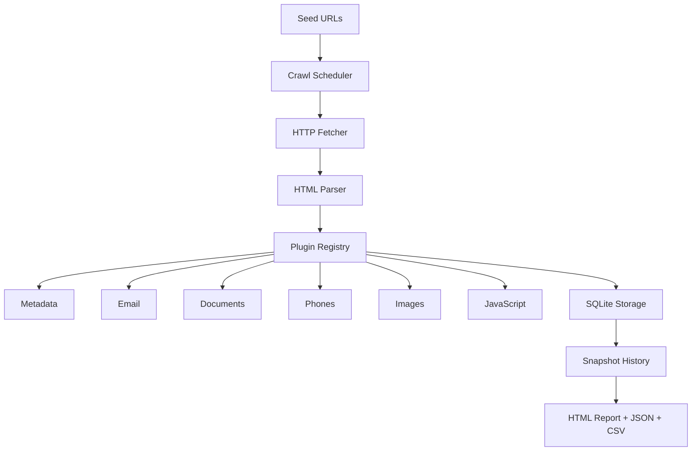

# Email Extractor & Website Crawler

[](https://www.python.org/)
[](LICENSE)
[](https://github.com/jillmoore4567-blip/email-crawler/actions/workflows/ci.yml)
[](https://docs.astral.sh/ruff/)
[](https://mypy.readthedocs.io/)
[](tests)

A modular Python crawler for authorized asset inventory and security
engineering. It supports incremental crawling, SQLite persistence,
schema migrations, historical snapshots, HTML reporting, JSON/CSV
exports, and a plugin-based extraction framework.

This project is intended for **authorized asset inventory and
defensive/security testing workflows only**.

Use is limited to authorized asset inventory and defensive/security
testing workflows.

Authorized scope: authorized asset inventory and defensive/security testing.

## Features

- Breadth-first crawling with configurable depth, concurrency, retries,
  and rate limits.
- Robust output pipeline: HTML dashboard, JSON, CSV, stats JSON,
  snapshot diff JSON, SQLite.
- Incremental crawling and historical snapshot comparison between runs.
- Plugin registry for extractor composition and extension.
- Structured telemetry/observability for timing, request behavior, and queue metrics.
- Migration-aware SQLite persistence with compatibility and fixture-based
  upgrade tests.

## Architecture



### Extractor Architecture

- Extractors are registered via [src/email_crawler/extractors/registry.py](src/email_crawler/extractors/registry.py).
- Built-ins are registered in deterministic order.
- The crawler composes runtime extractors through `build_default_extractors(...)`.

## Installation

```powershell
cd C:\Users\user\email-crawler
python -m venv .venv
.\.venv\Scripts\Activate.ps1
pip install -e .
```

## Quick Start

```powershell
email-crawler --seeds data/seeds.txt --max-pages 100 --max-depth 2 \
  --allow-domain example.com
```

Module mode also works:

```powershell
python -m email_crawler --seeds data/seeds.txt
```

## Configuration

- Defaults are read from [config.yaml](config.yaml).
- CLI values override YAML values.
- Seed input supports text or simple CSV (first column URL).

Core options:

- `--seeds`, `--max-pages`, `--max-depth`, `--allow-domain`, `--cross-domain`
- `--resume`, `--incremental`, `--checkpoint-dir`, `--checkpoint-every-pages`
- `--out-stats`, `--out-snapshot-diff`, `--out-sqlite`, `--out-html`

## Reports

- Dashboard output is generated in `output/report.html`.
- Snapshot Comparison includes detailed page-level change records and filtering.
- Performance Observability includes aggregate and per-seed timing metrics.

## Database Schema

### Database Schema and Migrations

Migrations are applied in-order from [src/email_crawler/migrations](src/email_crawler/migrations):

- `001_initial.sql`
- `002_add_runs.sql`
- `003_page_snapshots.sql`

The migration path preserves legacy data, is idempotent, and tracks
final state in `schema_version`.

## Plugin System

- Built-in extractor modules live under [src/email_crawler/extractors](src/email_crawler/extractors).
- Custom plugins can be registered through the registry abstraction.
- JavaScript extraction remains feature-gated by existing CLI/config settings.

## Testing

```powershell
python -m pip install -e .[dev]
pytest -q
```

CI in [.github/workflows/ci.yml](.github/workflows/ci.yml) runs
linting, staged mypy checks, docs sync tests, migration tests, packaging
validation, benchmark regression checks, and full test suite.

## Benchmarks

Generate benchmark results:

```powershell
python scripts/benchmark_synthetic.py
```

Dashboard performance benchmark (Phase 1 UI):

```powershell
python scripts/benchmark_dashboard.py \
  --output output/benchmarks/dashboard_latest.json
```

This benchmark uses synthetic datasets (1k, 5k, and 10k rows) and
measures:

- page load time
- global search latency
- filter latency
- sort latency

Target threshold per operation is 200 ms.

Latest local dashboard benchmark results:

| Rows | Page load (ms) | Search (ms) | Filter (ms) | Sort (ms) |
| --- | ---: | ---: | ---: | ---: |
| 1000 | 7.162 | 0.474 | 0.501 | 0.843 |
| 5000 | 17.381 | 2.853 | 2.175 | 4.670 |
| 10000 | 13.376 | 6.119 | 5.451 | 11.874 |

All operations are below the 200 ms threshold.

Check regressions against
[benchmarks/baseline.json](benchmarks/baseline.json):

```powershell
python scripts/check_benchmark_regression.py \
  --baseline benchmarks/baseline.json \
  --latest output/benchmarks/latest.json
```

## Outputs

- `report.html` — interactive crawl report.
- `stats.json` — crawl statistics and telemetry.
- `snapshot_diff.json` — historical comparison details.
- `findings.db` — SQLite persistence store.
- `results.csv` — spreadsheet-oriented export.

## Screenshots

Current screenshots are included in [docs/screenshots](docs/screenshots):

- [report-overview.png](docs/screenshots/report-overview.png)
- [snapshot-comparison.png](docs/screenshots/snapshot-comparison.png)
- [performance-metrics.png](docs/screenshots/performance-metrics.png)
- [crawl-summary.png](docs/screenshots/crawl-summary.png)

## Roadmap

- Additional extractor plugins.
- More reporting options and export views.
- Performance optimizations and scaling guidance.
- Accessibility improvements for report UI.
- Expanded examples and contributor documentation.

## Contributing

- Open an issue with context and reproduction steps.
- Keep PRs focused and include tests for behavioral changes.
- Run local quality gates before opening a PR:
  - `ruff check src tests`
  - `mypy --config-file mypy.ini`
  - `pytest -q`

## License

MIT License. See [LICENSE](LICENSE).
